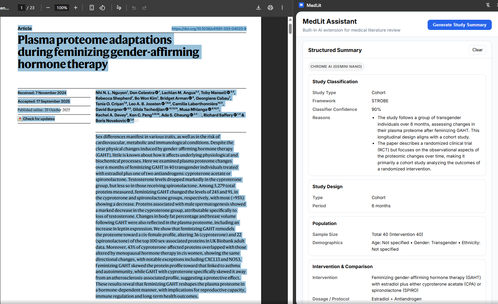

# MedLit

[](src/ai/aiClient.js) [](https://developer.chrome.com/docs/ai/prompt-api) [](manifest.json) [](https://developer.chrome.com/docs/ai/built-in) [](LICENSE)

MedLit is a Chrome extension for reading medical research papers. It extracts structured summaries, checks selected methods text, simplifies terminology, translates passages into English and answers questions in a side panel. Inference uses Chrome's built-in AI APIs, with no application backend or API keys.

Built for the [Google Chrome Built-in AI Challenge 2025](https://googlechromeai2025.devpost.com/). The [Devpost submission](https://devpost.com/software/medlit) includes the project presentation and demo.



Other views: [side panel](captures/sidepanel-overview.png), [study details and chat](captures/chat-strobe-details.png) and [accessibility settings](captures/settings-accessibility.png).

## Setup

Use desktop Chrome 138 or later with the [Prompt API available for extensions](https://developer.chrome.com/docs/ai/prompt-api). The [manifest](manifest.json) declares Chrome 122 as its installation minimum; that does not provide the AI APIs. Chrome documents support for Windows 10/11, macOS 13+, Linux and Chromebook Plus, with at least 22 GB free on the Chrome profile volume and either a GPU with more than 4 GB VRAM or a CPU with at least 16 GB RAM and four cores. Initial model downloads require a network connection; local inference can run offline once the required models are installed.

```sh
git clone https://github.com/ayanliger/medlit.git
```

1. Open `chrome://extensions` and enable "Developer mode".
2. Choose "Load unpacked" and select the cloned `medlit` directory.
3. Open an article page and click the MedLit toolbar action to open the side panel.
4. Run a summary or selection action and allow Chrome to download the required model if prompted. Inspect model availability in `chrome://on-device-internals` if initialization fails.

No package installation or build step is required. The [Translator API](https://developer.chrome.com/docs/ai/translator-api) downloads language models as needed. The [Rewriter API](https://developer.chrome.com/docs/ai/rewriter-api) remains a trial API; follow its current instructions for local testing with `chrome://flags/#rewriter-api` and restart Chrome after changing the flag. Simplification falls back to the Prompt API when Rewriter is unavailable, so enabling Rewriter is optional.

## Usage

- Choose "Generate Study Summary" to extract study design, population, interventions, outcomes and design-specific fields from the page. A selected passage can also be summarized from its context menu.
- Select a Methods passage and use "Assess methodology from selection" for the methodology rubric. Select the methods rather than an introduction or results section.
- Use "Simplify language from selection" for a rewrite with tone and length options, or "Translate selection to English" for translation.
- Ask questions after generating a summary, or choose "Chat with selection" to discuss a passage. Answers render as Markdown.
- Export results and chat history as Markdown or JSON. Settings include light, dark and high-contrast themes, a dyslexia-friendly font, font size and letter spacing.

## Architecture and technical decisions

The Manifest V3 [service worker](src/background/serviceWorker.js) opens the side panel and routes context-menu actions. The [content script](src/content/contentScript.js) supplies page metadata, article text and the last nonempty selection. The [side panel](src/sidepanel/main.js) coordinates analysis, rendering, chat and exports; [aiClient.js](src/ai/aiClient.js) manages model calls. The UI uses JavaScript modules without a framework, and Markdown rendering uses a bundled copy of marked.

- Classification runs before extraction in a separate Prompt API session. Classifier rules distinguish a study's own design from reviews cited in its introduction. Twelve study-type labels route papers to [extraction templates](src/ai/promptTemplates.js): CONSORT/PICO for trials, STROBE for observational designs, PRISMA for reviews, STARD for diagnostic studies, CARE for case reports and COREQ for qualitative research, with a separate basic-science schema. Normalization and keyword inference handle label variations and can infer a framework when the classifier omits one.
- Methodology assessment starts with an [English keyword-based content check](src/ai/validators.js). The prompt references Cochrane Risk of Bias but defines a custom rubric: four fields scored from 1 to 5, blinding flags and a model-generated overall score from 0 to 100. Code reduces scores when the effective content-confidence value is below 80%. This is a heuristic assessment, with no validation against expert ratings included in the repository.
- Simplification prefers Rewriter and retries its language options for API compatibility. Translation prefers Translator with an explicit source language, defaulting to English when none is supplied. Both can fall back to JSON responses from the Prompt API. Prompt and Rewriter use Gemini Nano; Translator uses a separate translation model. Unavailable models or failed requests produce [error states](src/ai/fallbacks.js), without a cloud fallback or placeholder analysis.
- Text blocks in classification, extraction and other prompt templates normalize whitespace and retain the first 12,000 characters. Chat uses the first 2,000 characters of a selection, or a structured summary plus the first 1,500 characters of article text. Only the last six history messages are included. Prompt sessions are created per task or question and released afterward to limit retained model state.

## Extraction limits and local data

Page extraction reads the first `<article>` element, falling back to `document.body`; it does not parse PDF files or perform OCR. Chrome's PDF viewer and restricted pages can prevent extraction, so selection-based actions depend on what Chrome exposes to the extension. Long articles can lose later methods and results because of the character limits above. Prompts and content checks are English-oriented, translation targets English, and reported confidence values are heuristics or model output rather than calibrated probabilities.

The [manifest](manifest.json) grants `<all_urls>` host access and injects the content script on matching pages to capture selections and respond to document requests. It also requests `activeTab`, `tabs`, `scripting`, `storage`, `contextMenus` and `sidePanel`. Chrome manages AI model downloads; MedLit has no application backend for article uploads. Article content, analysis and chat are held in memory, appearance preferences use `chrome.storage.local`, and exports are downloaded only on request.

## Development checks

After editing, reload the extension in `chrome://extensions` and reopen the side panel. There is no automated test suite or build command in this repository. A manual check should cover summary classification on different study designs, rejection of non-methods text, selection chat, simplification and translation with and without their dedicated APIs, Markdown/JSON exports and persistence of appearance settings. Confirm that unavailable AI APIs display an error instead of a fabricated result.

## License and credits

[MIT](LICENSE), copyright 2025 Ayan Messias Liger Coelho. The bundled [marked v15.0.12](src/sidepanel/lib/marked.min.js) is MIT-licensed, copyright 2011-2025 Christopher Jeffrey; see [marked](https://github.com/markedjs/marked) for its source.

Thanks to the Chrome Built-in AI team for the APIs and documentation, Google and Devpost for the challenge and medical professionals who provided usability feedback.
